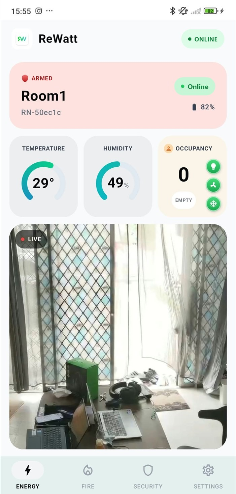
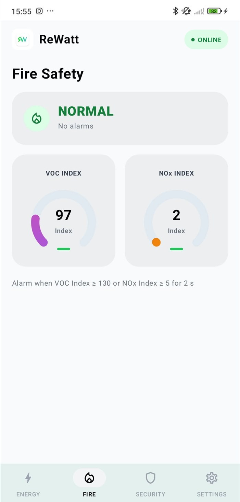
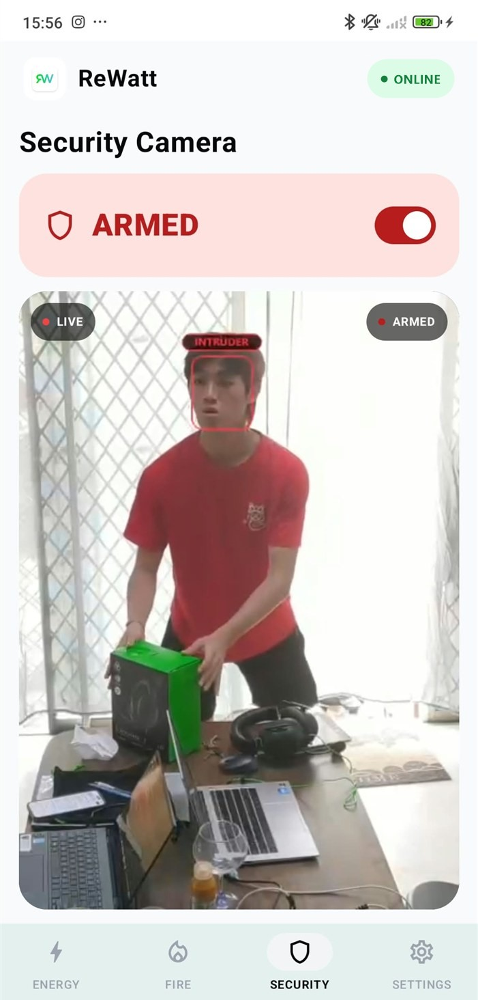
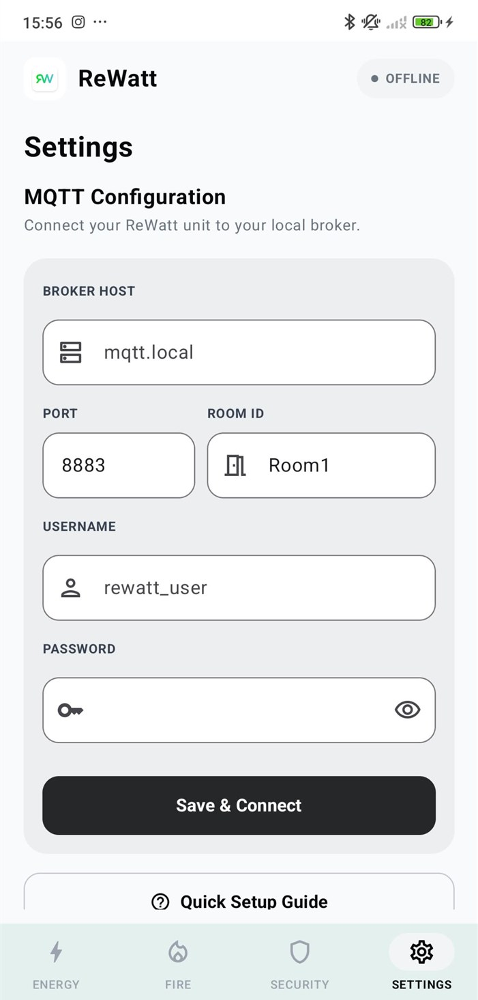
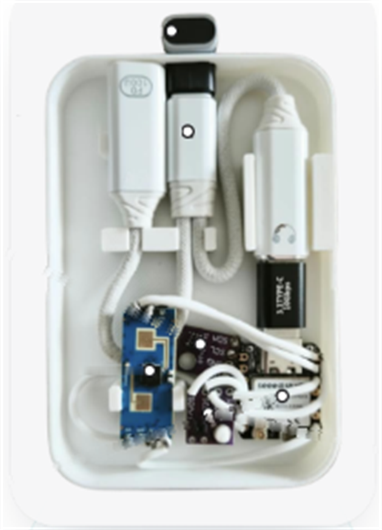
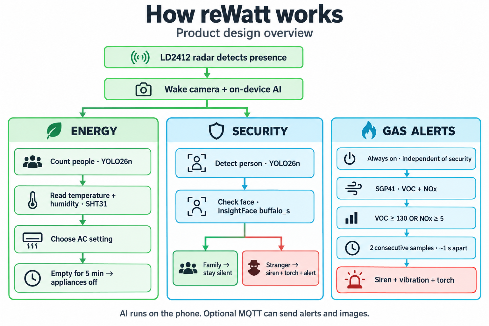
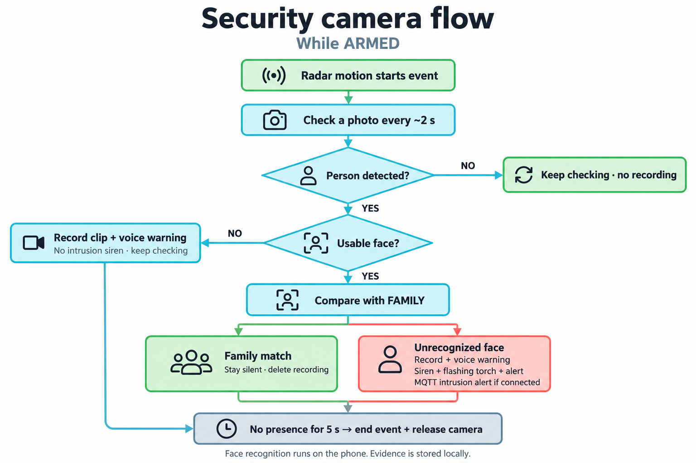

<p align="center">
  
  <br>
  
</p>

<h1 align="center">reWatt v2 — Giving old phones a second life</h1>

<p align="center">
  Turn an unused Android phone into a room sensor with on-device people counting,<br>
  gas alerts, and a security camera.
</p>

<p align="center">
  <a href="#quick-start">Build the app</a> ·
  <a href="https://junonnnnn.github.io/reWatt-deck/">Pitch deck</a> ·
  <a href="https://youtu.be/paHZ6IuO2EI">Presentation video</a> ·
  <a href="docs/user-manual/reWatt-User-Manual.pdf">User manual</a> ·
  <a href="#the-rewatt-module">Hardware</a> ·
  <a href="#mqtt-integration">MQTT integration</a>
</p>

## Choose a version

| Branch | Purpose |
| --- | --- |
| **`rewatt_v2` (this branch)** | Energy monitoring, gas alerts, security camera, and MQTT in one Android sensor node. |
| **[`main`](https://github.com/Chee613/reWatt/tree/main)** | Original campus energy-monitoring app with Sensor and Admin modes, Firebase sync, forecasts, and facility alerts. |

This branch imports the source, commit history, manual, and assets from
[tjh3281/rewatt-node at `2a6025c`](https://github.com/tjh3281/rewatt-node/tree/2a6025cc59a313e19ce754210dcd77cc6daff6a9).
The upstream code is preserved; this repository's README adds version navigation
and clone instructions for `Chee613/reWatt`.

Built for the **Sime Darby Property University Hackathon 2026 · Planet / People Track**.
reWatt reuses a phone's camera, processor, and connectivity, pairing them with an
ESP32-C6 sensor module to make room monitoring more accessible and reduce e-waste.

| **RM149** | **Android 6.0+** | **0 rewiring** | **100% on-device AI** |
| --- | --- | --- | --- |
| per module | any old phone | magnetic or adhesive mount | inference runs locally |

Product overview from the [pitch deck](https://junonnnnn.github.io/reWatt-deck/#2).
People counting and face recognition run on the phone. **Optional MQTT can send
readings, alerts, and images** to a broker you configure; see [data and privacy](#data-and-privacy).

## One phone, three roles

| Role | What this app provides |
| --- | --- |
| **Energy monitoring** | Temperature, humidity, YOLO people counts, and a camera-based estimate of whether lights are on. |
| **Gas alerts** | VOC and NOx Index readings, with a siren, vibration, torch, and MQTT alert when the application thresholds are met. |
| **Security camera** | Radar-triggered events, on-device family face recognition, local evidence recording, and intrusion alerts while armed. |

## App preview

<table>
  <tr>
    <th>Energy monitoring</th>
    <th>Gas monitoring</th>
  </tr>
  <tr>
    <td></td>
    <td></td>
  </tr>
  <tr>
    <th>Security camera</th>
    <th>Settings</th>
  </tr>
  <tr>
    <td></td>
    <td></td>
  </tr>
</table>

Screenshots from the included user manual. The app has **ENERGY**, **FIRE**,
**SECURITY**, and **SETTINGS** tabs, with English and Bahasa Melayu support.

One Android app runs on the mounted phone:

| Tab | What you see |
| --- | --- |
| **ENERGY** | Temperature, humidity, headcount (EMPTY at 0), lights · fan · AC status, and a live camera view. |
| **FIRE** | NORMAL / FIRE ALERT, with VOC Index and NOx Index gauges. |
| **SECURITY** | ARMED switch, live camera view, and alert history. |
| **SETTINGS** | MQTT configuration, Quick Setup Guide, security permissions, FAMILY faces, and alarm tests. |

The header badge shows **ONLINE** while the module is connected and **OFFLINE**
when it is not. Turn the phone sideways on ENERGY or SECURITY for a bigger live view.

## Quick start

### Prerequisites

- Android Studio with **Android SDK Platform 36** and **JDK 17**.
- **Product requirement: Android 6.0+**, with a working camera and USB host/OTG support
  for the sensor module, as described in the [pitch deck (slide 2)](https://junonnnnn.github.io/reWatt-deck/#2)
  and [user manual](docs/user-manual/reWatt-User-Manual.pdf).
- Android SDK Platform-Tools (`adb`) on your PATH and USB debugging enabled for command-line installation.
- For live readings, the [hardware module](#the-rewatt-module) running compatible firmware.
  **ESP32 firmware is not included** in this repository.

### Build and install

**Current source-build compatibility:** [app/build.gradle.kts](app/build.gradle.kts)
sets `minSdk = 26`, so APKs built from this checkout require **Android 8.0+**.
The Android 6.0+ product requirement and this build setting currently differ;
Android 6/7 installation support has not been verified.

```sh
git clone --branch rewatt_v2 --single-branch https://github.com/Chee613/reWatt.git
cd reWatt
```

Open the repository in Android Studio, let Gradle sync, and select the app module.
Android Studio can create the ignored `local.properties` file with your SDK path.
For terminal-only setup, create that file with `sdk.dir` pointing to your Android SDK.

Run from the repository root on Windows:

```powershell
.\gradlew.bat testDebugUnitTest assembleDebug
adb install -r app/build/outputs/apk/debug/app-debug.apk
```

On macOS or Linux:

```sh
sh ./gradlew testDebugUnitTest assembleDebug
adb install -r app/build/outputs/apk/debug/app-debug.apk
```

The debug APK is written to `app/build/outputs/apk/debug/app-debug.apk`.
Launch **reWatt** on the phone to complete setup.

### First run

The **Quick Setup Guide** opens on first launch; reopen it from
**Settings → Quick Setup Guide**:

1. Allow Camera & Location.
2. Turn off Battery Saver for reWatt.
3. Allow security camera permissions: notifications, microphone, full-screen alerts, and background operation.
4. Mount the phone on a wall or metal surface, camera facing the centre of the room.
5. Check the sensor view.
6. Name your space (for example, `Room1`, living room, or community hall).
7. Done.

Connect the module, approve USB access, and confirm **ONLINE** with live
temperature/humidity readings. Configure [MQTT](#mqtt-integration) if another
device needs readings or alerts, then follow [security setup](#security) to arm the camera.

Occupancy analysis is scheduled at the next ten-minute clock boundary (`:00`,
`:10`, `:20`, and so on). A live preview does not imply a newly calculated headcount.
Timing can be less precise when exact-alarm access is unavailable.

The [PDF user manual](docs/user-manual/reWatt-User-Manual.pdf) covers mounting,
permissions, screens, and sensor readings in more detail.

## The reWatt module

Three sensors, one ESP32-C6, one old phone, one app. The module clips onto the back
of the phone and connects to its charging port with a 180° adapter, so the phone
stays charged while it reads the sensors.

<p align="center">
  
</p>

The hardware specifications below describe the product design in the pitch deck.

| Part | What it does |
| --- | --- |
| **LD2412** — 24 GHz mmWave radar | Senses people, even when they sit still. Wakes the camera only when someone is there. |
| **SHT31** — temperature & humidity | Always on. Measures the room's comfort. |
| **SGP41** — VOC + NOx gas sensor | Always on. Watches for fire gases 24/7. |
| **ESP32-C6** — controller | All three sensors connect to it; it streams their data to the phone. |
| **Type-C 180° adapter** | Plugs the module into the phone's charging port. |
| **Type-C 1-to-2 splitter** (charge + USB) | Charges the phone and carries the sensor data at the same time. |

Power: **0.26 W** on standby; **3.4 W** only during a 15-second AI burst after the
radar senses someone. Camera and AI stay off in an empty room.

Module firmware, wiring, and smart-home actuator integration must be supplied separately.

## How it works

The diagram describes the product design. See [monitoring behavior](#monitoring-behavior)
for the features currently connected in this Android node checkout.



<details>
<summary>Read the product flow as text</summary>

```text
                 ┌──────────────── TRIGGER ────────────────┐
                 │  LD2412 mmWave radar senses a person    │
                 └───────────────┬─────────────────────────┘
                                 │ wakes the camera + on-device AI
              ┌──────────────────┴──────────────────┐
              ▼                                     ▼
   ENERGY OPTIMISATION                     SECURITY CAMERA
   presence → headcount (YOLO26n)          presence → person seen (YOLO26n)
   + temperature & humidity (SHT31)        → face check (InsightFace buffalo_s)
   → right AC setting                      → family: stays silent
   → no one for 5 min: appliances off      → stranger: siren, flashing light + alert

   ALWAYS ON:  SHT31 temperature & humidity · SGP41 fire gases
              ▼
   FIRE ALARM
   gas sensing 24/7 → VOC spike (early warning) → NOx rise (flaming) → loud siren + alert
```

</details>

- **Energy optimisation.** The product design uses headcount to choose an AC setting
  and switches off lights, fan, and AC when the room is empty.
- **Security camera.** A person without a visible face is recorded. Registered
  family stays silent; an unrecognized face triggers the recording warning,
  siren, flashing light, and alert.
- **Fire alarm.** The design uses VOC changes as an early warning and NOx changes
  as a possible burning indicator. The application responds to the thresholds below.
- **Privacy.** People counting and face checks run **100% on the phone**.
  Optional MQTT transmission is described under [data and privacy](#data-and-privacy).

## USB sensor protocol

Send **one JSON object per line at 115200 baud, 8 data bits, no parity, 1 stop bit**:

```json
{"radar":{"state":1,"mov_d":120,"mov_e":42,"stat_d":0,"stat_e":85},"temp":26.5,"hum":58.2,"voc":102,"nox":1}
```

| Field | Meaning |
| --- | --- |
| `radar.state` | `0`: empty; `1` or `3`: moving presence; `2`: stationary presence. Any value above zero is treated as presence. |
| `mov_d` / `stat_d` | Moving / stationary target distance in centimetres. |
| `mov_e` / `stat_e` | Moving / stationary radar energy values. |
| `temp` / `hum` | Temperature in °C / relative humidity in %. |
| `voc` / `nox` | Unitless Gas Index values, not ppm. A negative value indicates no valid reading. |

Gas fields are optional. The parser also accepts `VOC:102,NOX:1` lines; gas
gauges show `--` when readings are unavailable or stale. Malformed telemetry
is counted and dropped. See [UsbDataParser](app/src/main/java/com/rewatt/app/telemetry/UsbDataParser.kt).

VOC and NOx are Sensirion **Gas Index** values: unitless (not ppm), relative to
the room's baseline. Typical baseline values are approximately **100** for VOC
and **1** for NOx.

## Monitoring behavior

### Energy

The bundled **YOLO26n TensorFlow Lite** model counts people in camera captures.
Camera exposure provides a light-state estimate alongside the module's temperature
and humidity readings.

Appliance buttons currently change local UI state; the node does **not** send
appliance commands or set an AC temperature. The radar-driven energy entry/exit
trigger is not connected in the current code; scheduled occupancy captures remain available.

### Gas alerts

The fire monitor runs independently of the security arming switch whenever valid
SGP41 data arrives. **VOC Index ≥ 130 or NOx Index ≥ 5** in two consecutive
approximately one-second samples triggers the alarm. These are application
thresholds, not a guarantee that a particular gas or fire has been identified.

After dismissal, it re-arms after ten seconds of normal readings, or after five
minutes if values remain high. See [GasReading.kt](app/src/main/java/com/rewatt/app/telemetry/GasReading.kt)
and [FireMonitor.kt](app/src/main/java/com/rewatt/app/safety/FireMonitor.kt).

### Security

**Setup:**

1. Disarm security, then add five front-camera photos of each family member under
   **Settings → FAMILY faces**.
2. Turn on **ARMED** in **SECURITY** when leaving or at night.
3. Allow full-screen alerts. On Xiaomi/HyperOS, also allow **Show on Lock screen**
   and **Display pop-up windows while running in the background**.

While armed, fresh radar motion starts an event and face checks run approximately
every two seconds:



<details>
<summary>Read the security flow as text</summary>

```text
radar motion → event starts → photo every ~2 s
  no person                → keep checking (nothing recorded)
  person, no face          → record a clip + "You are being recorded" (no siren)
  face → check against FAMILY
        ✓ family           → silent; the clip is deleted
        ✗ stranger/masked  → "You are being recorded" + siren + flashing torch + alert + MQTT
nobody for 5 s → event ends, camera released
```

</details>

An event ends after five seconds without presence. Evidence is stored under
`files/security/events/<eventId>/`, with video parts, face-check photos, and
`event.json`. Retention removes older completed events after seven days or to
keep storage within 2 GiB; the active event is preserved.

Video is recorded as FHD 30 fps clips with audio in five-minute parts, subject to
device camera capabilities. Face-check models are bundled at
`app/src/main/assets/face/det_500m.onnx` and `face/w600k_mbf.onnx`, from
InsightFace [buffalo_s](https://github.com/deepinsight/insightface/releases/download/v0.7/buffalo_s.zip),
and run with ONNX Runtime. See [model terms](#license-and-model-terms).

After a reboot or force-stop, open the app again to resume camera operation.
Recognition depends on lighting, camera placement, and enrollment quality;
night-time face checks rely on room light or the torch.

## MQTT integration

Open **Settings → MQTT Configuration**, enter the broker host, port, room ID,
username, and password, then select **Save & Connect**. The default port is
**8883**, which enables TLS.

| Topic | Published data |
| --- | --- |
| `rewatt/sensors/<room>/telemetry` | Sensor readings, radar, headcount, light estimate, battery; also an on-demand base64 JPEG when sending the current photo. |
| `rewatt/sensors/<room>/fire` | Gas alert and VOC / NOx values. |
| `rewatt/sensors/<room>/intrusion` | Intrusion details, match scores, and a base64 JPEG. |
| `rewatt/sensors/<room>/security/event` | End-of-event summary. |

A separate consumer or dashboard can subscribe to these topics. This repository
contains the Android node app. Connection and topic handling live in
[MqttSyncRepository](app/src/main/java/com/rewatt/app/data/MqttSyncRepository.kt).

## Data and privacy

- **Local inference:** YOLO people counting and InsightFace face recognition run on the phone.
- **Local evidence:** security clips and face-check photos use app-private storage and the retention policy above.
- **Configured transmission:** MQTT can transmit telemetry and images to the configured broker and its subscribers.
- **Firebase:** the app initializes Firebase and includes `app/google-services.json`.
  Confirm the intended project with the maintainer before using cloud features;
  the configuration file does not grant backend access.

The build also accepts `GEMINI_API_KEY` and `MAPS_WEATHER_API_KEY` from
`local.properties`, Gradle properties, or environment variables. The current
sensor screen does not require these keys for USB readings or local inference.
Keep local credentials out of version control.

## Development

**Kotlin · Jetpack Compose / Material 3 · CameraX · Room · TensorFlow Lite · ONNX Runtime · HiveMQ MQTT**

- **Android:** `minSdk 26`, `target/compileSdk 36`, Java 17; English and Bahasa Melayu.
- **Sensing:** `usb-serial-for-android` for USB CDC and CameraX for camera capture.
- **On-device AI:** TensorFlow Lite for YOLO26n and ONNX Runtime for InsightFace buffalo_s.
- **Messaging:** HiveMQ MQTT client, with TLS on the default port 8883.
- **Background operation:** foreground services for USB sensing and camera capture;
  process-wide gas monitoring while readings arrive, including with the screen off.
- **Smart-home design:** the module uses the ESP-Matter SDK for integration;
  firmware is maintained separately from this Android repository.

Build configuration: [app/build.gradle.kts](app/build.gradle.kts) ·
[dependency versions](gradle/libs.versions.toml).

### Project structure

```text
app/src/main/java/com/rewatt/app/
├─ MainActivity.kt, ReWattApplication.kt
├─ core/         AppGraph (manual DI), LocaleManager
├─ usb/          UsbSentinelService — reads the module over USB serial
├─ telemetry/    UsbDataParser, radar / gas readings, freshness
├─ energy/       EnergyMonitor, appliance + occupancy state
├─ safety/       FireMonitor, FireAlarm, torch
├─ security/     IntrusionMonitor, face recognition, FAMILY faces, alarm, evidence
├─ perception/   CameraCaptureService, YOLO, live preview, light estimation
├─ data/         Telemetry + MQTT repositories, local database
└─ ui/           SensorScreen (ENERGY / FIRE / SECURITY / SETTINGS), setup, theme
app/src/main/assets/   yolo26n-1920.tflite, face/det_500m.onnx, face/w600k_mbf.onnx
docs/user-manual/      HTML source, build-pdf.ps1, PDF, and product assets
```

### Checks

Run from the repository root; replace `.\gradlew.bat` with `sh ./gradlew` on macOS/Linux.

```powershell
.\gradlew.bat testDebugUnitTest
.\gradlew.bat lintDebug
.\gradlew.bat connectedDebugAndroidTest
```

Instrumentation tests need a connected Android device or emulator. Existing
[unit tests](app/src/test/) cover telemetry parsing/freshness and perception
post-processing; [instrumentation tests](app/src/androidTest/) are also included.

To rebuild the manual on Windows with Microsoft Edge installed:

```powershell
.\docs\user-manual\build-pdf.ps1
```

## Roadmap

Planned milestones from the product roadmap:

- **Q4 2026 — Smart-home ecosystem:** integrate beyond the ESP-Matter SDK,
  including Apple Home and Xiaomi Home.
- **Township-wide monitoring:** a live dashboard for reWatt nodes across a township.
- **Q1 2028 — Global expansion:** full multi-language support and regional adaptations.

## Impact

**People · Planet** — reWatt aims to keep unused phones out of landfill, reduce
electricity wasted in empty rooms, and help monitor homes for fire and intruders
using hardware people already own.

## License and model terms

No repository-level license file is included. Bundled pretrained models have
separate terms: the existing project documentation identifies the InsightFace
`buffalo_s` weights as **non-commercial research only**. Review the upstream
[InsightFace model terms](https://github.com/deepinsight/insightface/tree/master/python-package#license)
and [Ultralytics model licensing](https://github.com/ultralytics/ultralytics#license)
before redistribution or commercial use.
