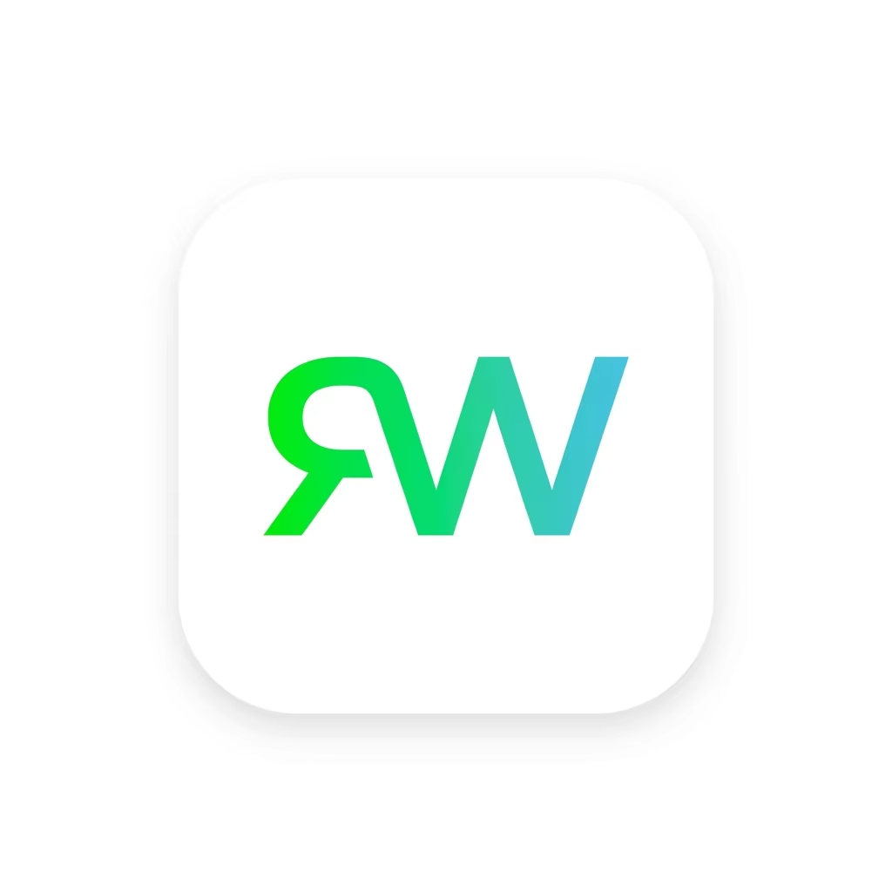

<p align="center">
  
  <br>
  
</p>

<h1 align="center">Giving old phones a second life</h1>

<p align="center">
  Turn an unused Android phone into a room sensor with on-device people counting,<br>
  gas alerts, and a security camera.
</p>

<p align="center">
  <a href="#quick-start">Build the app</a> ·
  <a href="https://junonnnnn.github.io/reWatt-deck/">Pitch deck</a> ·
  <a href="https://www.youtube.com/watch?v=paHZ6IuO2EI">Watch on YouTube</a> ·
  <a href="docs/user-manual/reWatt-User-Manual.pdf">User manual</a> ·
  <a href="#hardware">Hardware</a> ·
  <a href="#mqtt-integration">MQTT integration</a>
</p>

Built for the **Sime Darby Property University Hackathon 2026 · Planet / People Track**.
reWatt reuses a phone's camera, processor, and connectivity, pairing them with an
ESP32-C6 sensor module to make room monitoring more accessible and reduce e-waste.

## One phone, three roles

| Role | What this app provides |
| --- | --- |
| **Energy monitoring** | Temperature, humidity, YOLO people counts, and a camera-based estimate of whether lights are on. |
| **Gas alerts** | VOC and NOx Index readings, with a siren, vibration, torch, and MQTT alert when the application thresholds are met. |
| **Security camera** | Radar-triggered events, on-device family face recognition, local evidence recording, and intrusion alerts while armed. |

People counting and face recognition run on the phone. **Optional MQTT can send
readings, alerts, and images** to a broker you configure; see [data and privacy](#data-and-privacy).

## App preview

<table>
  <tr>
    <th>Energy monitoring</th>
    <th>Gas monitoring</th>
  </tr>
  <tr>
    <td></td>
    <td></td>
  </tr>
  <tr>
    <th>Security camera</th>
    <th>Settings</th>
  </tr>
  <tr>
    <td></td>
    <td></td>
  </tr>
</table>

Screenshots from the included user manual. The app has **ENERGY**, **FIRE**,
**SECURITY**, and **SETTINGS** tabs, with English and Bahasa Melayu support.

## Quick start

### Prerequisites

- Android Studio with **Android SDK Platform 36** and **JDK 17**.
- **Product requirement: Android 6.0+**, with a working camera and USB host/OTG support
  for the sensor module, as described in the [pitch deck (slide 2)](https://junonnnnn.github.io/reWatt-deck/#2)
  and [user manual](docs/user-manual/reWatt-User-Manual.pdf).
- Android SDK Platform-Tools (`adb`) on your PATH and USB debugging enabled for command-line installation.
- For live readings, the [hardware module](#hardware) running compatible firmware.
  **ESP32 firmware is not included** in this repository.

### Build and install

**Current source-build compatibility:** [app/build.gradle.kts](app/build.gradle.kts)
sets `minSdk = 26`, so APKs built from this checkout require **Android 8.0+**.
The Android 6.0+ product requirement and this build setting currently differ;
Android 6/7 installation support has not been verified.

```sh
git clone https://github.com/tjh3281/rewatt-node.git
cd rewatt-node
```

Open the repository in Android Studio, let Gradle sync, and select the app module.
Android Studio can create the ignored `local.properties` file with your SDK path.
For terminal-only setup, create that file with `sdk.dir` pointing to your Android SDK.

Run from the repository root on Windows:

```powershell
.\gradlew.bat testDebugUnitTest assembleDebug
adb install -r app/build/outputs/apk/debug/app-debug.apk
```

On macOS or Linux:

```sh
sh ./gradlew testDebugUnitTest assembleDebug
adb install -r app/build/outputs/apk/debug/app-debug.apk
```

The debug APK is written to `app/build/outputs/apk/debug/app-debug.apk`.
Launch **reWatt** on the phone to complete setup.

### First run

1. Follow the **Quick Setup Guide**; reopen it from **Settings → Quick Setup Guide**.
2. Grant camera and location access, and allow background operation as prompted.
3. Mount the phone facing the room, connect the module, and approve USB access.
4. Confirm the header shows **ONLINE** and temperature/humidity readings arrive.
   This badge describes the USB module connection, not MQTT connectivity.
5. To use security, disarm it first, register family under **Settings → FAMILY faces**,
   grant microphone, notification, and full-screen alert access, then enable **ARMED**.
6. Configure [MQTT](#mqtt-integration) if another device needs readings or alerts.

Occupancy analysis is scheduled at the next ten-minute clock boundary (`:00`,
`:10`, `:20`, and so on). A live preview does not imply a newly calculated headcount.
Timing can be less precise when exact-alarm access is unavailable.

The [PDF user manual](docs/user-manual/reWatt-User-Manual.pdf) covers mounting,
permissions, screens, and sensor readings in more detail.

## Hardware

<p align="center">
  
</p>

| Component | Purpose |
| --- | --- |
| **ESP32-C6** | Streams sensor data to the phone over USB serial. |
| **LD2412 · 24 GHz mmWave radar** | Supplies moving and stationary presence readings for monitoring and armed security events. |
| **SHT31** | Measures temperature and relative humidity. |
| **SGP41** | Supplies optional VOC and NOx Gas Index values. |
| **USB adapter and charge/data splitter** | Connects the module while allowing a compatible phone to charge. |

Module firmware, wiring, and smart-home actuator integration must be supplied separately.

### USB sensor protocol

Send **one JSON object per line at 115200 baud, 8 data bits, no parity, 1 stop bit**:

```json
{"radar":{"state":1,"mov_d":120,"mov_e":42,"stat_d":0,"stat_e":85},"temp":26.5,"hum":58.2,"voc":102,"nox":1}
```

| Field | Meaning |
| --- | --- |
| `radar.state` | `0`: empty; `1` or `3`: moving presence; `2`: stationary presence. Any value above zero is treated as presence. |
| `mov_d` / `stat_d` | Moving / stationary target distance in centimetres. |
| `mov_e` / `stat_e` | Moving / stationary radar energy values. |
| `temp` / `hum` | Temperature in °C / relative humidity in %. |
| `voc` / `nox` | Unitless Gas Index values, not ppm. A negative value indicates no valid reading. |

Gas fields are optional. The parser also accepts `VOC:102,NOX:1` lines; gas
gauges show `--` when readings are unavailable or stale. Malformed telemetry
is counted and dropped. See [UsbDataParser](app/src/main/java/com/rewatt/app/telemetry/UsbDataParser.kt).

## Monitoring behavior

### Energy

The bundled **YOLO26n TensorFlow Lite** model counts people in camera captures.
Camera exposure provides a light-state estimate alongside the module's temperature
and humidity readings.

Appliance buttons currently change local UI state; the node does **not** send
appliance commands or set an AC temperature. The radar-driven energy entry/exit
trigger is not connected in the current code; scheduled occupancy captures remain available.

### Gas alerts

The fire monitor runs independently of the security arming switch whenever valid
SGP41 data arrives. **VOC Index ≥ 130 or NOx Index ≥ 5** in two consecutive
approximately one-second samples triggers the alarm. These are application
thresholds, not a guarantee that a particular gas or fire has been identified.

After dismissal, it re-arms after ten seconds of normal readings, or after five
minutes if values remain high. See [GasReading.kt](app/src/main/java/com/rewatt/app/telemetry/GasReading.kt)
and [FireMonitor.kt](app/src/main/java/com/rewatt/app/safety/FireMonitor.kt).

### Security

While armed, fresh radar motion starts an event and face checks run approximately
every two seconds:

| Observation | Response |
| --- | --- |
| No person detected | Continue checking without recording evidence. |
| Person detected, no usable face | Record a clip and play the recording warning; no intrusion siren. |
| Registered family member | Stay silent and discard the event recording. |
| Unrecognized face | Record evidence, play the warning, trigger the alarm, and send an MQTT intrusion alert if connected. |

An event ends after five seconds without presence. Evidence is stored under
`files/security/events/<eventId>/`, with video parts, face-check photos, and
`event.json`. Retention removes older completed events after seven days or to
keep storage within 2 GiB; the active event is preserved.

After a reboot or force-stop, open the app again to resume camera operation.
Recognition depends on lighting, camera placement, and enrollment quality.

## MQTT integration

Open **Settings → MQTT Configuration**, enter the broker host, port, room ID,
username, and password, then select **Save & Connect**. The default port is
**8883**, which enables TLS.

| Topic | Published data |
| --- | --- |
| `rewatt/sensors/<room>/telemetry` | Sensor readings, radar, headcount, light estimate, battery; also an on-demand base64 JPEG when sending the current photo. |
| `rewatt/sensors/<room>/fire` | Gas alert and VOC / NOx values. |
| `rewatt/sensors/<room>/intrusion` | Intrusion details, match scores, and a base64 JPEG. |
| `rewatt/sensors/<room>/security/event` | End-of-event summary. |

A separate consumer or dashboard can subscribe to these topics. This repository
contains the Android node app. Connection and topic handling live in
[MqttSyncRepository](app/src/main/java/com/rewatt/app/data/MqttSyncRepository.kt).

## Data and privacy

- **Local inference:** YOLO people counting and InsightFace face recognition run on the phone.
- **Local evidence:** security clips and face-check photos use app-private storage and the retention policy above.
- **Configured transmission:** MQTT can transmit telemetry and images to the configured broker and its subscribers.
- **Firebase:** the app initializes Firebase and includes `app/google-services.json`.
  Confirm the intended project with the maintainer before using cloud features;
  the configuration file does not grant backend access.

The build also accepts `GEMINI_API_KEY` and `MAPS_WEATHER_API_KEY` from
`local.properties`, Gradle properties, or environment variables. The current
sensor screen does not require these keys for USB readings or local inference.
Keep local credentials out of version control.

## Development

**Kotlin · Jetpack Compose / Material 3 · CameraX · Room · TensorFlow Lite · ONNX Runtime · HiveMQ MQTT**

Build configuration: [app/build.gradle.kts](app/build.gradle.kts) ·
[dependency versions](gradle/libs.versions.toml).

Paths below are relative to `app/src/main/java/com/rewatt/app/` unless stated otherwise.

| Path | Responsibility |
| --- | --- |
| [`core/`](app/src/main/java/com/rewatt/app/core/) | Shared application dependencies and locale management. |
| [`usb/`](app/src/main/java/com/rewatt/app/usb/) · [`telemetry/`](app/src/main/java/com/rewatt/app/telemetry/) | USB service, payload parsing, and sensor freshness. |
| [`perception/`](app/src/main/java/com/rewatt/app/perception/) · [`energy/`](app/src/main/java/com/rewatt/app/energy/) | Camera capture, YOLO, light estimation, and energy state. |
| [`safety/`](app/src/main/java/com/rewatt/app/safety/) · [`security/`](app/src/main/java/com/rewatt/app/security/) | Gas monitoring, alarms, family recognition, and evidence storage. |
| [`data/`](app/src/main/java/com/rewatt/app/data/) · [`ui/`](app/src/main/java/com/rewatt/app/ui/) | Repositories, persistence, MQTT, and Compose screens. |
| [`app/src/main/assets/`](app/src/main/assets/) (repository root) | Bundled YOLO and face-recognition models. |
| [`docs/user-manual/`](docs/user-manual/) (repository root) | HTML manual, PDF, and product assets. |

### Checks

Run from the repository root; replace `.\gradlew.bat` with `sh ./gradlew` on macOS/Linux.

```powershell
.\gradlew.bat testDebugUnitTest
.\gradlew.bat lintDebug
.\gradlew.bat connectedDebugAndroidTest
```

Instrumentation tests need a connected Android device or emulator. Existing
[unit tests](app/src/test/) cover telemetry parsing/freshness and perception
post-processing; [instrumentation tests](app/src/androidTest/) are also included.

To rebuild the manual on Windows with Microsoft Edge installed:

```powershell
.\docs\user-manual\build-pdf.ps1
```

## Future direction

The project vision includes smart-home actuator integration, township-wide
monitoring, and broader language support. These are future goals; this repository
currently provides the Android sensor node.

## License and model terms

No repository-level license file is included. Bundled pretrained models have
separate terms: the existing project documentation identifies the InsightFace
`buffalo_s` weights as **non-commercial research only**. Review the upstream
[InsightFace model terms](https://github.com/deepinsight/insightface/tree/master/python-package#license)
and [Ultralytics model licensing](https://github.com/ultralytics/ultralytics#license)
before redistribution or commercial use.
